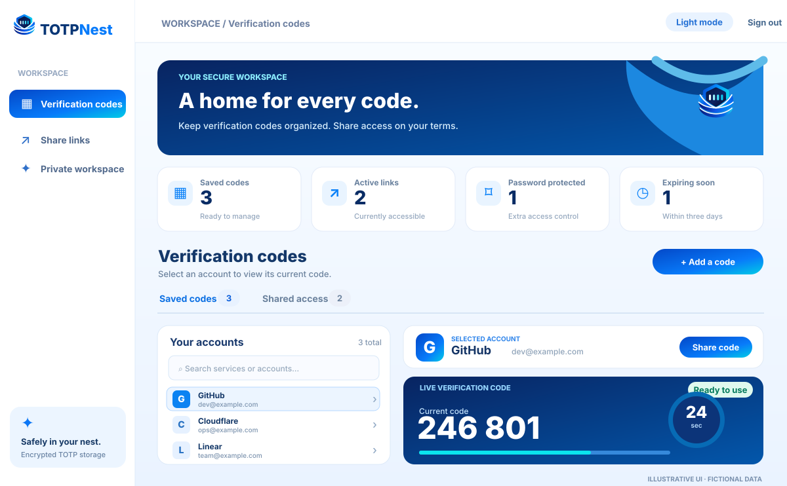
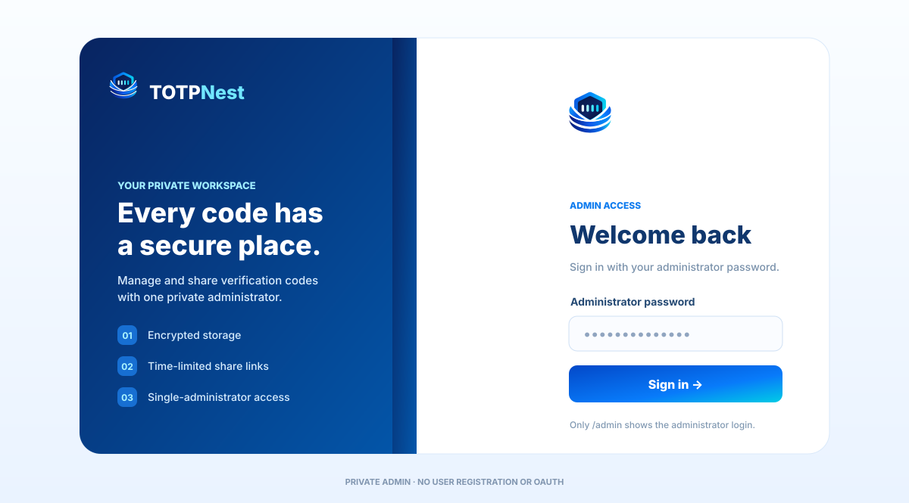
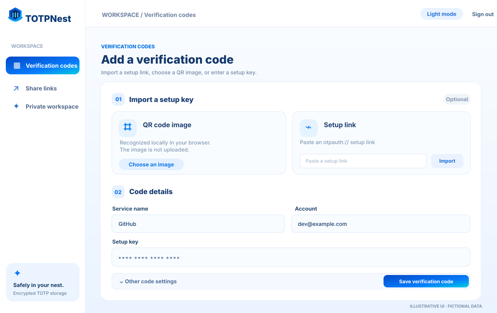
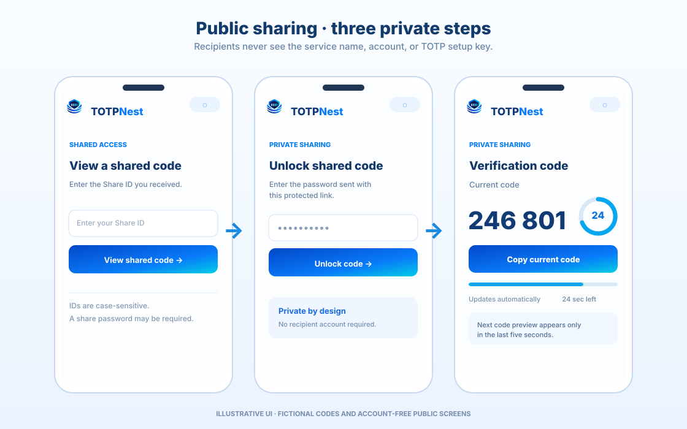
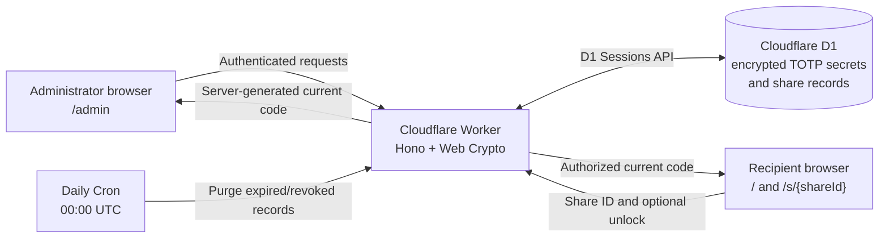

<div align="center">

<h1></h1>

**Your TOTP codes, safely nested.**

A self-hosted, browser-based authenticator manager for one administrator, with secure, time-limited code sharing. Powered by **Cloudflare Workers + D1**.

[](https://github.com/roseshot/TOTPNest/actions/workflows/ci.yml)
[](https://developers.cloudflare.com/workers/)
[](https://react.dev/)
[](https://www.typescriptlang.org/)
[](LICENSE)

[Explore the interface](#interface-preview) · [Get started](#quick-start) · [Deployment](#deployment) · [Security](#security-model-and-limitations)

</div>

> [!IMPORTANT]
> TOTPNest is a **single-administrator, server-generated TOTP manager**, not a zero-knowledge vault or an offline authenticator. Keep the Worker encryption key safe, protect your admin password, and treat public share URLs as credentials.

## At a glance

| Private administration | Controlled code sharing | Built for Cloudflare |
| --- | --- | --- |
| One administrator password; groups for saved codes; search; direct `otpauth://` and local QR image import. | Multiple links per code; optional passwords; Views and UV statistics; selectable expiration; immediate revocation. | Workers + Hono + Web Crypto; encrypted secrets in D1; Sessions API; daily expired/revoked-record cleanup. |

- **Supported codes:** SHA-1, SHA-256 and SHA-512; 6 or 8 digits; 15–120-second periods.
- **Easy to use:** Responsive admin dashboard and public sharing pages, light/dark appearance, accessible copy actions and clear expiry states.
- **Deliberately small scope:** No guest registration, administrator OAuth, passkeys, offline code generation, or native mobile app.
- **Security-focused delivery:** Same-origin APIs, no-store responses, security headers, rate limiting and primary-first authorization checks.

## Interface preview

The vector previews below illustrate the **implemented visual layout** with fictional services, share IDs and codes. They are **not screenshots of production data**. Each illustration now includes the official [four-bar shield-and-nest symbol](public/totpnest-logo.svg), matching the application UI and favicon.

### Administrator workspace

Select a saved account, see the **current valid** TOTP code and its countdown, and choose whether to edit, delete or share it.



### Secure sign-in and code import

The administrator signs in with a **single password**. Code setup accepts an `otpauth://` link, a QR **image file processed in the browser**, or a manually entered setup key.

<table>
<tr>
<td width="50%" valign="top">

<br /><sub><strong>Password-only administrator sign-in</strong> — no email account or third-party login required.</sub>
</td>
<td width="50%" valign="top">

<br /><sub><strong>Add a verification code</strong> — import a QR image or setup link, then review and save.</sub>
</td>
</tr>
</table>

### Public sharing on mobile

The public site is separate from `/admin`. Visitors can enter a case-sensitive Share ID at `/`, unlock password-protected links, and view a code at `/s/{shareId}` **without seeing the issuer, account or setup secret**.



## How TOTPNest works

### For the administrator

1. Open `/admin` and enter the administrator password.
2. Create a **group** (for example, Work or Personal) and move codes into it, or leave them ungrouped.
3. **Add a code** by importing an `otpauth://totp/...` link, selecting a QR image, or supplying the setup key manually. QR decoding happens **locally in the browser**.
4. Search your entries and select one to view the current code. The Worker generates TOTP values; it encrypts setup secrets with **AES-256-GCM** before storing them in D1.
5. Select **Share code** to create a recipient link. Choose a lifetime (1 hour, 24 hours, 7 days, 30 days, or until revoked), an optional password, and a private admin note.
6. Manage active share links from the dashboard, including **Views** and approximate **UV** for each link. Revocation prevents new code requests **immediately**. Revoked and expired records are removed during the daily UTC-midnight cleanup.

### For a recipient

1. Open a provided `/s/{shareId}` link, or enter its Share ID at `/`. Letter case matters.
2. If the owner protected the link, enter the separate share password; **no recipient account** is needed.
3. Copy the **currently valid** code. One progress bar and a seconds-remaining label show the countdown. During the last five seconds, the next code appears separately as **not active yet**; it becomes current automatically at rollover.
4. Ask the sender for a replacement if the share was revoked or expired.

### Request and storage architecture



**Trust boundaries:** The Worker holds the encryption capability and generates codes. D1 stores ciphertext and share metadata. Share-code and unlock requests check access against fresh, primary-first D1 sessions. A public share does not expose administrator account details.

## Quick start

**Requirements:** Node.js 26.12.1+, a Cloudflare account with Workers and D1, and Wrangler access.

```sh
git clone https://github.com/roseshot/TOTPNest.git
cd TOTPNest
npm install
npm run check
```

For a working instance, create or select your D1 database, set `D1_DATABASE_NAME` and `D1_DATABASE_ID` in your build environment, and configure the independent Worker secrets `ADMIN_PASSWORD` and `DATA_ENCRYPTION_KEY`. Apply migrations before deployment. **Do not put real keys or TOTP data in the repository.**

| Task | Where to go |
| --- | --- |
| Deploy from GitHub `main` | [Cloudflare Workers Builds](#cloudflare-workers-builds-git-connected-deployments) |
| Provision secrets and migrate D1 | [First deployment and migrations](#first-deployment-and-migrations) |
| Develop using local D1 | [Local development](#local-development) |
| Understand share revocation and cleanup | [Share deletion and automatic expiration](#share-deletion-and-automatic-expiration) |
| Plan backups and key recovery | [Backup and recovery](#backup-and-recovery) |
| Review the security trade-offs | [Security model and limitations](#security-model-and-limitations) |

## Features

- Sign in to the administration dashboard with **one admin password**.
- Add, edit, delete, and search TOTP entries. Create, rename, and delete groups, filter by group, and move accounts between groups without changing their secrets.
- Supports SHA-1, SHA-256, and SHA-512; 6- or 8-digit codes; periods of 15 to 120 seconds.
- Import an `otpauth://totp/...` link or upload a QR code image. QR recognition runs in the browser; images are not uploaded.
- TOTP secrets are encrypted with AES-256-GCM by the Worker before being written to D1.
- Create multiple share links per TOTP entry, with separate expiration dates, revocation controls, and per-link **Views** and approximate **UV** (unique browsers).
- Revoked and expired shares stop working immediately, but their D1 records are removed together by a once-daily UTC midnight Cron Trigger.
- Share URLs use a 22-character case-sensitive Base62 ID with approximately 131 bits of randomness, without a separate URL token.
- **Public links:** anyone holding the URL can view the shared code.
- **Password-protected links:** recipients must also enter a dedicated share password. No guest sign-up is required.
- The share page **never shows issuer, service, or account details**. It displays the current code, copy control, status, and **one progress-bar countdown** (no circular timer).
- The initial request fetches only the **current code**. The page requests and previews the **next code** during the **final five seconds** of the current period.
- An upcoming code is shown separately with a **not active yet** label. The copy button always copies the currently valid code; when time expires, the upcoming code replaces it automatically.
- The browser updates the countdown locally; no per-second API polling or WebSocket is required.
- The public homepage (`/`) accepts a Share ID; `/admin` is the only administrator UI route, with no admin navigation on public pages.
- The interface uses the TOTPNest blue-and-cyan nest mark, rounded surfaces, responsive layouts, and the free Inter font loaded from Google Fonts with system-font fallbacks. Public HTML, static resources, and API responses contain `noindex` directives.
- Share-code and unlock endpoints have a Cloudflare-native rate limit to reduce abusive D1 reads without writing to D1 on each successful code view.
- After five incorrect admin or share-password attempts from a visitor IP within 30 minutes, block that visitor for 30 minutes. Successful share unlocks do not reset the visitor-wide failure budget.
- After ten unavailable share ID requests from a visitor IP within 24 hours, block that visitor from share access for 24 hours.

## Stack

- React 19, TypeScript, Vite, jsQR
- Cloudflare Workers with Hono and the Web Crypto API
- Cloudflare D1 (SQLite) with optional global read replication and Sessions API bookmarks
- Workers Static Assets for the SPA and security headers

## Dependency versions

Dependencies are pinned to the current stable releases as of October 23, 2026, including React 19.3.1, Hono 4.13.13, Vite 8.3.5, Vitest 5.0.5, TypeScript 7.0.2 and Wrangler 4.151.3. See `package.json` for the full version list.

## D1 read replication

TOTPNest uses the D1 **Sessions API** rather than querying the D1 binding directly. Enabling global read replication is an account/database setting in the Cloudflare dashboard; it does not require modifying the database schema.

- **Read-only admin lists** (`GET /api/admin/entries`, `GET /api/admin/groups`) start sessions with `first-unconstrained` so a nearby read replica may serve the query.
- The browser sends the most recent `X-D1-Bookmark` with subsequent admin API requests. Each response includes its session's latest bookmark, allowing reads after a write to observe at least that database version even if routed to a replica.
- **Share-code requests, share authorization, unlocks, the share list (for current visit totals), and mutations** start with `first-primary`, so revocation and expiration checks are not performed against stale replicas. Later queries within that same session may use a replica while maintaining sequential consistency.
- **Admin session checks** explicitly query a fresh primary-first session, ensuring sign-out or session invalidation is not hidden by replication lag.
- All writes still execute against the primary database. The Sessions API does not make D1 writes faster or prevent cloud network outages.

Read replication may return an older list snapshot to a *new browser session without a bookmark*. The browser bookmark is scoped to the admin tab's session storage and is never sent from public share pages.

Cloudflare documentation: https://developers.cloudflare.com/d1/best-practices/read-replication/#use-sessions-api

## Appearance and everyday language

The frontend uses the official four-bar shield-and-nest mark, redrawn as a self-contained SVG from the selected logo artwork. The full wordmark has been outlined into vector paths and needs no downloaded fonts. Interface text uses **Inter**, a proportional (not monospaced) font loaded through Google Fonts (OFL-licensed), with system font fallbacks. Verification-code digits use the tabular numeral feature so 0–9 occupy equal widths. The layout includes a responsive admin sidebar, a verification-code workspace, and a separate public sharing experience. Brand updates do not change TOTP generation, share authorization, or encryption.

| Brand asset | Purpose |
| --- | --- |
| [`public/totpnest-logo.svg`](public/totpnest-logo.svg) | Official standalone shield-and-nest icon for the app, favicon and mobile public pages. |
| [`public/totpnest-wordmark.svg`](public/totpnest-wordmark.svg) | Full logo with outlined `TOTPNest` lettering for documentation and project presentation. |
| [`docs/images/`](docs/images/) | Illustrated interface previews embedding the same official emblem (sample data only). |

All logo and preview SVGs are stored in this repository and do not request external resources. The interface requests the Inter stylesheet from `fonts.googleapis.com` and font files from `fonts.gstatic.com`. Its Content Security Policy allows only those additional stylesheet/font hosts, not external scripts.

- Dark and light modes are available on the homepage, shared-code pages, sign-in screen, and administrator dashboard.
- The first visit follows the system color preference; manual theme choices are saved in the browser and reused on later visits.
- A self-hosted script applies the saved theme before the page is shown. Only the stylesheet and font allowlist is extended for the Google Fonts CDN.
- User-facing labels, buttons, confirmations, help text, and common errors use clear everyday language. Less common verification-code options remain available under **Other code settings**.
- Both themes share the new brand styling and responsive layouts. Public pages continue to have no administrator entry point.

## Public routes and indexing

- `/` shows a Share ID entry form. IDs are case-sensitive; valid IDs navigate to `/s/{shareId}` without calling an API during input.
- `/s/{shareId}` displays the public code page or password challenge. Unknown or invalid pages display public-only error messages.
- `/admin` is the **only** UI path displaying the administrator sign-in form or dashboard. Public pages never link to the administrative area.
- Buttons, cards, badges, and progress indicators follow the same rounded visual system in both themes.

Search indexing is discouraged by an HTML `<meta name="robots" content="noindex, ...">` element, `X-Robots-Tag` on static assets, and the same header on Worker API responses. `robots.txt` allows crawling so compliant search engines can **see** the `noindex` directive. Blocking crawler access in `robots.txt` would prevent Google from observing `noindex` and could cause URLs linked elsewhere to remain discoverable in search results. This does not guarantee that every crawler will comply, and it does not provide confidentiality or authorization.

Reference: https://developers.google.com/search/docs/crawling-indexing/block-indexing

## Requirements

- Node.js 26.12.1 or later
- A Cloudflare account with Workers and D1 enabled (the Free plan is supported)
- A domain managed through Cloudflare DNS for a Custom Domain
- Access to a terminal with Wrangler

## Deployment

### Cloudflare Workers Builds (Git-connected deployments)

Connect this repository in Cloudflare **Workers & Pages**, then configure **Settings > Builds**:

| Setting | Value |
| --- | --- |
| Production branch | `main` |
| Root directory | Repository root (`/`) |
| Build command | `npm run check` |
| Deploy command | `npm run deploy:worker` |

Under **Build variables and secrets** for the production build, add both variables:

| Build variable | Value |
| --- | --- |
| `D1_DATABASE_NAME` | The exact name of your existing Cloudflare D1 database |
| `D1_DATABASE_ID` | The UUID of that same D1 database |

The committed `wrangler.jsonc` deliberately contains placeholders for both fields. `npm run prepare:wrangler` validates the build variables and writes `wrangler.generated.jsonc` at the repository root. Wrangler deploys using only this generated configuration, which is gitignored. Missing or invalid build variables stop deployment before Wrangler starts. `npm run check` uses the placeholder template solely for a dry-run build, so GitHub Actions does not require access to production database identifiers.

**Set the deploy command exactly as shown.** The `deploy:worker` script applies pending D1 migrations before deploying the Worker. Cloudflare's default `npx wrangler deploy` skips this project's generated configuration and migration step, so it must not be used for this setup. When Builds are enabled, each push to `main` triggers the configured build and deployment; GitHub Actions independently validates the code but does not deploy.

Build variables are not Worker runtime secrets. Configure `ADMIN_PASSWORD` and `DATA_ENCRYPTION_KEY` separately in **Worker Settings > Variables and Secrets**, as secret values. The application's D1 binding remains `DB`; do not put the D1 UUID in a Worker runtime `vars` binding.

The committed Wrangler template declares both runtime secrets under `secrets.required`. This declaration is preserved in `wrangler.generated.jsonc`, so Wrangler refuses a production deployment when either secret name is absent from the deployed Worker. It does **not** create secrets, validate their values, or inject build-only variables into the Worker. Add the required runtime secrets before retrying the deployment.

### First deployment and migrations

If the database does not already exist, create one first:

```sh
npm install
npx wrangler login
npx wrangler d1 create totpnest
```

Use the **same existing database name and UUID** in your Cloudflare build variables. For local CLI operations, export the two values in your shell (they are not read automatically from Cloudflare Builds or `.dev.vars`):

```sh
export D1_DATABASE_NAME="totpnest"
export D1_DATABASE_ID="your-existing-d1-database-uuid"
npm run db:migrate:remote
```

Automatic deployment applies pending remote migrations before updating the Worker. Review migrations before pushing to `main` and back up the production database first. The additive share-ID migration preserves existing entry secrets and share records, but rotates previous public links. If database migration fails, the Worker deployment stops.

Set two independent **Worker Secrets** in the Cloudflare dashboard or, when using the CLI, with the generated configuration:

```sh
npm run prepare:wrangler
npx wrangler secret put ADMIN_PASSWORD --config wrangler.generated.jsonc
npx wrangler secret put DATA_ENCRYPTION_KEY --config wrangler.generated.jsonc
```

- `ADMIN_PASSWORD`: use a unique, randomly generated password (20+ characters recommended; at least 16 are required by the Worker).
- `DATA_ENCRYPTION_KEY`: a **separate, randomly generated 32-byte key encoded as base64url**. This is not a password.

Generate a valid encryption key on your own machine:

```sh
node -e "console.log(require('node:crypto').randomBytes(32).toString('base64url'))"
```

**Never commit real passwords, encryption keys, TOTP secrets, backup exports, or account data.**

If an API request returns `The service is missing required encryption secrets`, inspect **Workers & Pages > totpnest > Settings > Variables and Secrets**. Both secret names must exist on the deployed Worker, `ADMIN_PASSWORD` must contain at least 16 characters, and `DATA_ENCRYPTION_KEY` must decode from Base64URL to exactly 32 bytes (normally 43 unpadded characters). After adding or updating secrets in the dashboard, select **Deploy** to activate the new Worker version. Keep these values out of **Build variables and secrets**.

If you have already stored TOTP entries, **reuse the original `DATA_ENCRYPTION_KEY`**. Replacing it will make existing encrypted entries and share tokens undecryptable. A missing-secret deployment should not be repaired by generating a different encryption key if an original key exists.

Run the complete checks and deploy from a local shell with both D1 environment variables set:

```sh
npm run check
npm run deploy
```

In Cloudflare Dashboard, open **Workers & Pages > totpnest > Settings > Domains & Routes** and add your Custom Domain, such as `totp.example.com`. Visit `https://totp.example.com/admin`.

The repository deploys automatically only when **Cloudflare Workers Builds** has been enabled and configured as described above. GitHub Actions remains validation-only. No production D1 identifiers or runtime secrets are committed. Disable unneeded preview endpoints and apply appropriate Cloudflare security rules before using real TOTP secrets.

## Local development

Provide `D1_DATABASE_NAME` and `D1_DATABASE_ID` in your **shell environment**, even when working with the local D1 emulator. Both local commands use the generated Wrangler configuration but keep database operations local by default:

```sh
export D1_DATABASE_NAME="totpnest"
export D1_DATABASE_ID="your-existing-d1-database-uuid"
cp .dev.vars.example .dev.vars
# Replace both placeholders in .dev.vars with test-only credentials.
npm run db:migrate:local
npm run dev
```

Wrangler serves the built application at `http://127.0.0.1:8787` by default. Re-run `npm run dev` after changing the frontend, or run `npm run dev:ui` for the Vite frontend server against a separately running Worker. The development secrets file is ignored by Git.

## Groups, views and unique visitors

Migration `0004_groups_and_views.sql` adds groups and successful-view receipts **without changing or re-encrypting existing codes**. All existing entries initially appear under **Ungrouped**. A deleted group moves its codes back to Ungrouped; it does not delete codes, secrets, or related share links.

Migration `0005_share_unique_visitors.sql` adds an optional visitor hash to existing visit receipts. Migration `0006_share_analytics_and_history.sql` adds recipient-visible labels, compact Views counters, rolling UV records, and non-sensitive share history. Existing Views are preserved. Previous visits have no visitor identity, so **UV starts from zero when this migration is deployed**; it cannot be reconstructed retroactively.

The administrator dashboard displays two numbers for each active share link. Revoked, expired, and account-deleted shares appear under **Share links → History**; history retains metadata and aggregate counts but not bearer IDs, password verifiers, or TOTP secrets.

- **Views:** Successful current-code views, counted once per page load. Network retries and automatic code updates do not add views. Reloading or reopening the page adds a view, even for the same person.
- **UV (unique visitors):** An estimate of **distinct browsers** that have successfully viewed a current code using that link. The browser generates a random ID per share and keeps it in local storage across reloads. A cleared-storage browser, private-browsing session or second device can count as another UV, and two people sharing a browser can count as one. It is **not a count of identifiable people**.

No view or UV is added for password prompts, incorrect passwords, expired/revoked links or failed code requests. UV counting is scoped to each share link. The browser stores an opaque local-storage key derived from a SHA-256 hash of the share path, never the share ID itself. The server stores only a hash of the random browser ID **scoped to the share**, together with the already-stored random per-page visit ID and view timestamp. No IP addresses, user agents, device fingerprints or account names are stored in the view receipts. Two different shares cannot be linked together using the stored hashes. The public API does not return statistics.

A malformed or missing browser ID does not invalidate an otherwise valid view; that view contributes to Views but not UV. When browser storage is blocked, a temporary random ID is used and the count may increase across reloads. Statistics are best-effort: a database write failure never prevents an authorized code from being returned, so numbers may undercount. Receipts are deleted with the share during normal cleanup.

D1 stores both metrics and supplies per-link deduplication. No Cloudflare KV binding is needed. Only authenticated administrators can read statistics.

The Inter typeface is fetched from a free Google Fonts CDN. Font requests are made by the visitor's browser, not by the Worker, and may reveal the visitor's IP address to the font provider as with other external resources. If the CDN is unavailable, the system font stack remains usable.

## Sharing behavior

1. Sign in as the administrator and select a TOTP entry.
2. Choose **Share**, optionally require an access password, choose an expiration period, and add a private admin note.
3. Send the generated link to the recipient. Its path contains a case-sensitive, cryptographically random 22-character Base62 share ID; no URL token is needed.
4. The recipient opens the link. A password prompt is shown only for password-protected shares.
5. The page displays the current code with one progress-bar countdown. During the last five seconds, it requests and previews the next code, clearly marked as not yet active.
6. Revoking a link immediately blocks new requests; expiration blocks access at the configured time. The associated D1 records are cleaned up during the daily UTC-midnight Cron Trigger.

The Worker checks share-ID existence, password-unlock tickets (when applicable), expiration, revocation, and visitor lockouts **on every code request**. Expiration never depends on whether background cleanup has run. Share pages and visitor APIs do not return issuer, account, or TOTP secret.

The next code preview is informational and must not be used before its countdown reaches zero. The copy button always copies the current valid code; the preview takes over automatically when its time starts.

## Security model and limitations

[](#security-model-and-limitations)
[](#security-model-and-limitations)
[](#security-model-and-limitations)
[](#security-model-and-limitations)


- The Worker **can decrypt TOTP secrets**, so this is **not an end-to-end encrypted or zero-knowledge vault**. Compromise of the Worker, its deployment access, or its encryption secret may expose TOTP secrets.
- `ADMIN_PASSWORD` is held as a Worker Secret, not in D1. Administrator sessions use random 256-bit tokens; D1 contains only session hashes. Session cookies use `HttpOnly; Secure; SameSite=Strict` on HTTPS.
- Updating `ADMIN_PASSWORD` invalidates prior admin sessions because the stored session verifier is bound to the configured password.
- Share IDs are 22 random Base62 characters (approximately 131 bits of entropy). Possession of the ID grants access to an unprotected share, so keep complete URLs private. The ID is stored in D1; a D1 data breach can expose active share links. There is no independent URL token.
- Protected-share passwords use a purpose-separated, keyed HMAC verifier derived from the Worker encryption secret. Each share has a distinct identifier. Worker and D1 rate limits discourage online guessing; **use a strong share password**.
- Successful password unlocks issue a short-lived 15-minute HMAC-signed ticket bound to the share ID. The browser keeps the ticket in session storage only.
- APIs check request origin, avoid cross-origin access, stream and cap JSON request bodies at 8 KiB, and disable caching.
- The Cloudflare rate-limiting binding caps share-code and unlock traffic together, and admin login separately, at approximately 120 requests per minute per visitor IP, per Cloudflare location. Limits are approximate rather than globally strict. D1-backed failure counters use primary-first sessions: five incorrect admin-password attempts per visitor within 30 minutes; five incorrect share-password attempts per visitor/share pair within 30 minutes; and ten unavailable Share ID requests per visitor within 24 hours. Rate-limit IP identifiers are domain-separated HMAC values derived from the Worker key, not raw addresses or unsalted IP digests. Shared IPs can still encounter edge-level throttling. Configure additional Cloudflare security rules for high-risk deployments.
- QR imports are limited to 10 MiB files and 20-megapixel images. TOTP imports require canonical Base32 lengths and padding bits. Static assets include a content security policy, no-referrer policy, and search-indexing restrictions.
- **Revocation cannot invalidate codes already delivered.** Replacing a compromised TOTP secret requires reconfiguring 2FA at the underlying service.
- There is no offline code generation; if the Worker or its dependencies are unavailable, fresh codes cannot be retrieved.
- The Free plan has resource and CPU limits. Views use one aggregate counter per share; page-view deduplication receipts are retained for 30 days and per-share unique-browser hashes for 90 days. Public-sharing traffic may still require additional edge-level rules.

## Share ID migration and compatibility

Migration `0002_share_ids.sql` adds a unique public ID to every share without deleting existing entries, shares, or their password verifiers. Existing shares receive a new 32-character, 128-bit random hexadecimal ID; new shares use the shorter 22-character Base62 format.

**All URLs created before this change are invalidated.** Previously shared UUID + fragment-token links must be replaced using the admin dashboard's **Copy link** action. Revocation and expiration metadata are preserved. The legacy token columns remain in D1 temporarily for a backward-compatible database rollout; the new application never uses these token values to authorize visitors. Do not share a URL containing an obsolete `#token=` fragment.

The new URL is a bearer capability: anyone knowing the share ID can access an unprotected share. Password-protect sensitive shares, use short expirations, and rotate or revoke compromised links.

## Share deletion and automatic expiration

- **Revoke:** `DELETE /api/admin/shares/:id` immediately marks the share as revoked (`revoked_at`) without deleting the row. New visitor requests are denied right away. The record remains in D1 until the next scheduled UTC midnight cleanup. The underlying TOTP entry is not deleted.
- **Expire:** requests are denied as soon as `expires_at` passes, independently of database cleanup. The record remains until the next scheduled UTC midnight cleanup. Admin lists exclude expired and revoked records while they await deletion.
- **Cleanup:** Cloudflare Cron Triggers run the Worker's `scheduled()` handler daily at **00:00 UTC (GMT+0)** (`0 0 * * *`). The cleanup deletes shares revoked before that scheduled midnight or expired at or before it. The handler uses the scheduled event's UTC timestamp as its cutoff, so a delayed invocation cannot remove shares that became inactive after midnight. Cloudflare may execute a trigger later than the scheduled time; physical deletion is therefore not guaranteed at the exact second. Active shares without expiration remain untouched.
- **Existing data:** the historical migration `0003_share_cleanup.sql` added an expiration index and removed then-inactive records when first applied. Applied migrations are left unchanged; new revocations and expirations follow the daily cleanup schedule. Active shares, their passwords, and all TOTP entries are preserved. Back up the database before production migration if historical records matter.

Cloudflare Workers KV was intentionally not added: KV provides eventual consistency, and cached values may remain visible in some regions after deletion. Public share-code authorization continues to use primary-first D1 sessions so a revoked link stops authorizing new code requests immediately, even when its row is retained until midnight. As with any TOTP system, codes already delivered before revocation cannot be invalidated by deleting the share.

References: [Cron Triggers](https://developers.cloudflare.com/workers/configuration/cron-triggers/) and [Workers KV consistency](https://developers.cloudflare.com/kv/concepts/how-kv-works/).

## Backup and recovery

**Back up both the D1 database and the original `DATA_ENCRYPTION_KEY` separately.** Losing the encryption key makes the encrypted secrets unrecoverable.

For example, export D1 from a trusted machine:

```sh
npm run prepare:wrangler
npx wrangler d1 export DB --remote --config wrangler.generated.jsonc --output backup.sql
```

Keep exports in encrypted offline storage, **outside the repository**. Practice restoration with a separate test database before attempting a production recovery. Also retain the backup/recovery codes for important external accounts.

Do not replace `DATA_ENCRYPTION_KEY` without a deliberate migration: existing entry secrets and saved share tokens would otherwise become undecryptable. The repository does not automatically back up Cloudflare Secrets.

## Validation

```sh
npm run check
```

The CI pipeline validates code: TypeScript type checking, UV migration, per-share visitor deduplication and privacy tests, RFC 6238 and Base32 canonicalization tests, bounded JSON parsing, otpauth URI parsing, cryptography, D1 Sessions API routing/bookmark tests, random share ID generation, lockout behavior, midnight share cleanup and immediate access revocation, public route isolation, responsive branding styles, indexing headers, migration compatibility, build-time D1 configuration generation tests, Vite production bundling, and a Wrangler Worker dry-run build. No copywriting or language audit runs in CI. GitHub Actions runs the checks on commits to `main` and on pull requests.

## API overview

| Method | Route | Access |
| --- | --- | --- |
| POST | `/api/admin/login` | Admin password |
| POST | `/api/admin/logout` | Authenticated admin |
| GET | `/api/admin/session` | Session status |
| GET / POST | `/api/admin/entries` | Authenticated admin |
| GET / POST | `/api/admin/groups` | Authenticated admin |
| PUT / DELETE | `/api/admin/groups/:id` | Authenticated admin |
| PUT / DELETE | `/api/admin/entries/:id` | Authenticated admin |
| PUT | `/api/admin/entries/:id/group` | Authenticated admin |
| POST | `/api/admin/entries/:id/code` | Authenticated admin |
| POST | `/api/admin/entries/:id/next` | Authenticated admin; final 5 seconds |
| GET / POST | `/api/admin/shares` | Authenticated admin |
| GET | `/api/admin/shares/:id/link` | Authenticated admin |
| DELETE | `/api/admin/shares/:id` | Authenticated admin |
| POST | `/api/share/:id/unlock` | Valid share ID and share password |
| POST | `/api/share/:id/code` | Valid share ID; unlock ticket when protected |
| POST | `/api/share/:id/next` | Valid share ID and unlock ticket when protected; final 5 seconds |

Clients cannot select arbitrary timestamps to retrieve unlimited future codes.

## License

TOTPNest's application source code is licensed under the **GNU Affero General Public License v3.0 (AGPL-3.0)**. The complete license text is in [`LICENSE`](LICENSE).

Because TOTPNest is a network-accessible application, AGPL-3.0's network-use provision (Section 13) is relevant: if you run a modified version for users to interact with remotely over a network, you must offer those users the Corresponding Source of that modified version as required by the license.

### Third-party packages and licenses

The following table lists the packages declared directly in `package.json`. License names are the packages' published license identifiers; transitive dependencies are not included in this direct-dependency inventory.

| Package | License |
| --- | --- |
| `hono` | MIT License |
| `jsqr` | Apache License 2.0 |
| `react` | MIT License |
| `react-dom` | MIT License |
| `@cloudflare/workers-types` | MIT License |
| `@types/react` | MIT License |
| `@types/react-dom` | MIT License |
| `@vitejs/plugin-react` | MIT License |
| `typescript` | Apache License 2.0 |
| `vite` | MIT License |
| `vitest` | MIT License |
| `wrangler` | Apache License 2.0 |

- **Inter font files** in `public/fonts/` are licensed separately under the **SIL Open Font License 1.1 (OFL-1.1)**. The font copyright and full license notice are included in [`public/fonts/OFL.txt`](public/fonts/OFL.txt).
- The application source code remains under **GNU Affero General Public License v3.0 (AGPL-3.0)**. Third-party package and font licenses apply independently; they are not relicensed under the application's AGPL-3.0 license.

For the complete terms, consult each package's own license file or package metadata in its published distribution. This table covers direct dependencies only; packages pulled in transitively retain their respective licenses and should be reviewed separately when preparing a redistribution.
